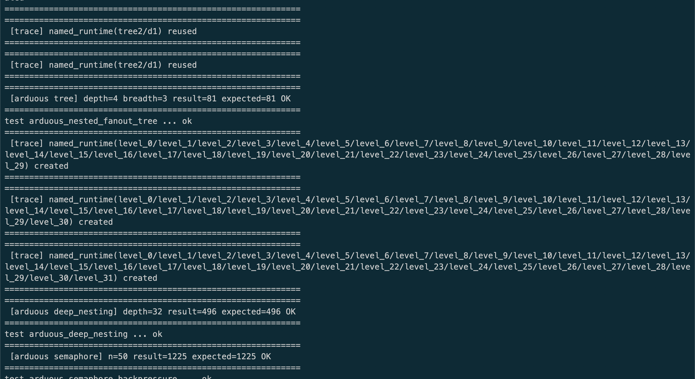

# arduous_rt

`arduous_rt` is a small, focused Rust crate that provides **process-global Tokio runtimes** that can be created, reused, nested, and composed. It is designed for applications and libraries that need a stable asynchronous execution backend without threading a runtime handle through every layer of the call stack.



## Highlights

- **One call, one runtime**: `global_rt()` returns a `&'static tokio::runtime::Runtime`.
- **Named runtimes**: create or reuse dedicated runtimes by name with `named_runtime(name)`.
- **Nested / hierarchical runtimes**: `child_runtime`, `nested_runtime`, and `nested_chain` model parent/child relationships.
- **Cooperation**: runtimes exchange data over Tokio channels, barriers, shared state, etc.
- **Reentrancy safety**: `run(rt, fut)` executes a future on `rt`, awaiting it directly when already running on `rt` (no deadlock, no panic).
- **CPU-aware stress testing**: `available_threads()` and `stress_chain()` size workloads to the machine.
- **Built-in observability**: `arduous_trace!` events through `tracing`, `timed`/`timed_async` helpers, and `benchmark`/`benchmark_async`.
- **Proof-oriented tests**: deterministic aggregation proofs across N nested runtimes, repeated-run determinism, and external network smoke tests.

## Installation

Add the dependency to your `Cargo.toml`:

```toml
[dependencies]
arduous_rt = { path = "../arduous_rt" }
```

Or, once published:

```toml
[dependencies]
arduous_rt = "0.1"
```

## Quick start

```rust
use arduous_rt::global_rt;

fn main() {
    let rt = global_rt();
    let answer = rt.block_on(async { 21 + 21 });
    println!("answer = {answer}");
}
```

## Core API

### `global_rt() -> &'static Runtime`

Returns the default process-global runtime (named `"global"`). The same instance is returned on every call.

```rust
let rt = global_rt();
rt.spawn(async { println!("hello from the global runtime"); });
```

### `named_runtime(name) -> &'static Runtime`

Lazily creates and caches a runtime identified by `name`. Repeated calls with the same name return the same instance; different names return distinct runtimes.

```rust
let producer = arduous_rt::named_runtime("producer");
let consumer = arduous_rt::named_runtime("consumer");
```

Aliases: `runtime(name)`, `global_rt_named(name)`.

### `child_runtime(parent, child) -> &'static Runtime`

Creates (or reuses) a runtime whose name is `"{parent}/{child}"`.

### `nested_runtime(path: &[&str]) -> &'static Runtime`

Creates (or reuses) a runtime from an arbitrary ancestor path.

### `nested_chain(n) -> Vec<&'static Runtime>`

Builds a chain of `n` runtimes, shallow to deep, returning every level.

### `nested_leaf(n) -> &'static Runtime`

Returns the deepest runtime of an `n`-level chain.

### `available_threads() -> usize`

Returns the number of threads available on the current machine (minimum 1).

### `stress_chain() -> Vec<&'static Runtime>`

Builds a nested chain sized to `available_threads()` (clamped to 1..=16).

## Composition helpers

### `is_running_on(rt) -> bool`

Returns `true` when the current thread is already executing on `rt`.

### `run(rt, fut).await -> R`

Runs `fut` on `rt`. If the caller is already on `rt`, the future is awaited directly (reentrant, no deadlock); otherwise it is spawned and awaited.

```rust
let rt = arduous_rt::global_rt();
let result = rt.block_on(async {
    // Safe even though we are already on `rt`.
    arduous_rt::run(rt, async { 7 }).await
});
```

### `spawn_on(rt, fut) -> JoinHandle<R>`

Spawns `fut` on `rt` and returns its join handle.

### `stress(runtimes, tasks_per).await -> i64`

Spawns `tasks_per` tasks on each runtime in `runtimes` and aggregates their results.

## Observability

### `arduous_trace!` macro

Emits an `INFO`-level event through the [`tracing`](https://docs.rs/tracing)
facade. Install a subscriber in your binary to see the events — the bundled
examples use `tracing_subscriber::fmt`:

```rust
tracing_subscriber::fmt::init();
arduous_rt::arduous_trace!("starting worker {}", id);
```

### `banner(message)`

Prints a highly visible bordered banner around `message`.

### `timed(label, f) -> R` / `timed_async(label, f).await -> R`

Runs a synchronous closure or async future while logging elapsed time.

### `benchmark(label, iterations, f)` / `benchmark_async(label, iterations, f).await`

Runs `f` repeatedly and logs min/avg/max timings.

## Examples

Run the bundled examples:

```bash
cargo run --example cooperating_runtimes
cargo run --example nested_runtimes
cargo run --example nested_proofs
cargo run --example stress_test
cargo run --example trace_demo
cargo run --example demo_backpressure
cargo run --example demo_panic
```

## Tests

The crate ships an extensive test suite (lib + integration):

```bash
# Default suite (deterministic)
cargo test

# Include ignored external/network tests
cargo test -- --ignored
# or
make test-all
```

Test categories:

- **Lib tests**: basic runtime, named/distinct runtimes, cooperation, nesting, reentrancy, timing/benchmark utilities.
- **Negative tests**: expected-failure cases (`#[should_panic]`, closed channels, aborted tasks).
- **Arduous tests** (`tests/arduous.rs`): deep nesting, massive spawns, channel stress, shared state, barriers, timeouts, panics, large payloads, fan-out trees, etc.
- **External tests** (ignored by default): HTTP smoke tests against `example.com` and `httpbin.org`.

## Tooling

A `Makefile` and `.justfile` are provided:

```bash
make build          # cargo build
make test           # cargo test -- --nocapture
make test-all       # cargo test -- --include-ignored
make test-external  # ignored network tests
make proofs         # run nested proof example
make stress         # run stress example
make fmt            # cargo fmt
make clean          # cargo clean
```

`.cargo/config.toml` sets `RUST_TEST_NOCAPTURE=1` so `cargo test` always shows timing and proof output.

## Design notes

- Runtimes are **leaked** (`Box::leak`) so they live for `'static`. This is intentional: a global runtime must outlive all users. The cost is that runtimes are never dropped.
- `named_runtime` uses a process-global `Mutex<HashMap>` guarded by `once_cell::Lazy`.
- `run()` detects reentrancy via `Handle::id()` comparison, avoiding `block_on` on the same runtime.
- External tests are `#[ignore]`d so the default suite stays deterministic and offline-friendly.

## Demo: concurrency failure modes

Four examples deliberately invoke common Tokio issues for demonstration and observability:

```bash
# Completes normally
cargo run --example demo_backpressure
cargo run --example demo_panic

# Intentionally hangs (run under a timeout)
timeout 5s cargo run --example demo_deadlock
timeout 5s cargo run --example demo_starvation
```

### Observability with tokio-console

Enable the console feature and the unstable cfg:

```bash
cargo run --example demo_backpressure --features console
```

In another terminal:

```bash
cargo install --locked tokio-console
tokio-console
```

`.cargo/config.toml` already sets `--cfg tokio_unstable`, which is required for task-level introspection.

## Safety and limitations

- Creating many runtimes is expensive; `stress_chain()` caps depth at 16.
- `Runtime::block_on` must not be called from within an async context on the *same* runtime. Use `run()` or `spawn()` instead.
- The crate does not shut down runtimes; they persist until process exit.

-